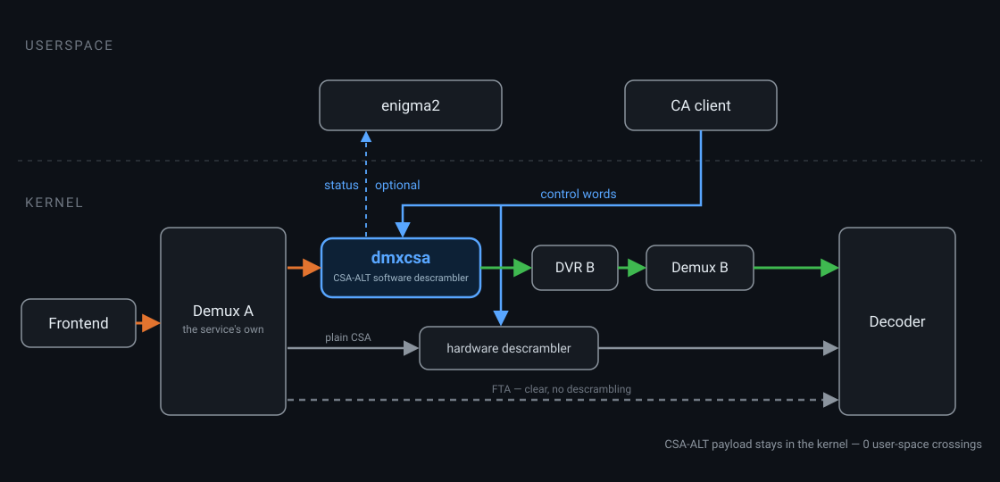

# kernel-module-dmxcsa

`dmxcsa` descrambles **CSA-ALT** inside the kernel, so the userspace player does
not have to. One scrambled service is handled in software by the module; free
and plain-CSA services stay on the hardware path, untouched.

This repository contains the **kernel modules** and the ready-to-use
**opkg (`.ipk`) and Debian (`.deb`) installers**, one per receiver, published as
GitHub **Releases**.

## How it works



The module taps the service's demux node the way a recording would, descrambles
the stream in software, and plays the result to the decoder through a second
"shadow" demux node. Keys, pids and the algorithm come from the CA ioctls a
local CA client writes.

## Install

Download the package for your receiver from the latest
[Release](../../releases/latest) and install it.

**opkg receivers** (most enigma2 images):

```sh
opkg install kernel-module-dmxcsa_<version>_<box>.ipk
```

**Debian-based receivers** (certain Dreamboxes):

```sh
dpkg -i kernel-module-dmxcsa_<version>_<box>.deb
```

The installer copies the module to `/lib/modules/<kernel>/extra/`, runs
`depmod`, and sets up boot autoload so the module loads after the DVB driver.
**Reboot** afterwards. Verify with:

```sh
cat /proc/dmxcsa
```

## What a Release contains

Each release `vX.Y` provides, per receiver:

| File | What it is |
|---|---|
| `dmxcsa-<box>.ko` | the raw kernel module |
| `kernel-module-dmxcsa_<version>_<box>.ipk` | opkg installer (module + autoload) |
| `kernel-module-dmxcsa_<version>_<box>.deb` | Debian installer (selected Dreamboxes) |

Each module is built against that receiver's exact kernel, so it matches the
running kernel's version magic (and, where the kernel uses it, its symbol
versions).

## Requirements

- a local CA client that writes the descrambler keys with
  **`extended_cw_api = 1`** (so the algorithm is signalled to the kernel)
- where the userspace player has a software descrambler of its own, disable it,
  otherwise the two work against each other

## License

GPL-2.0-or-later.
